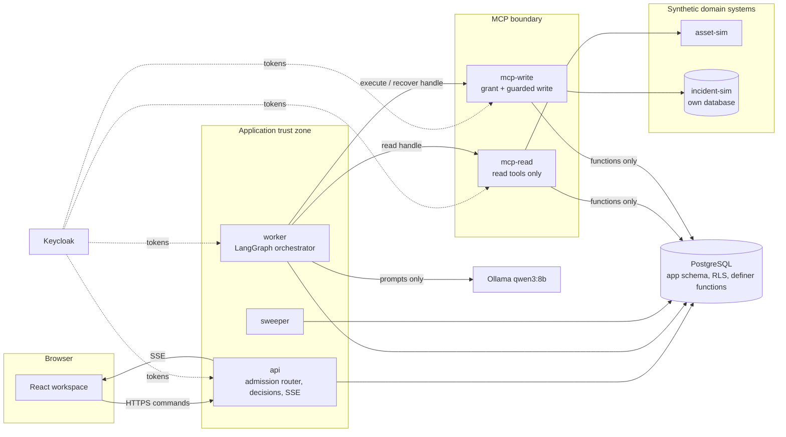
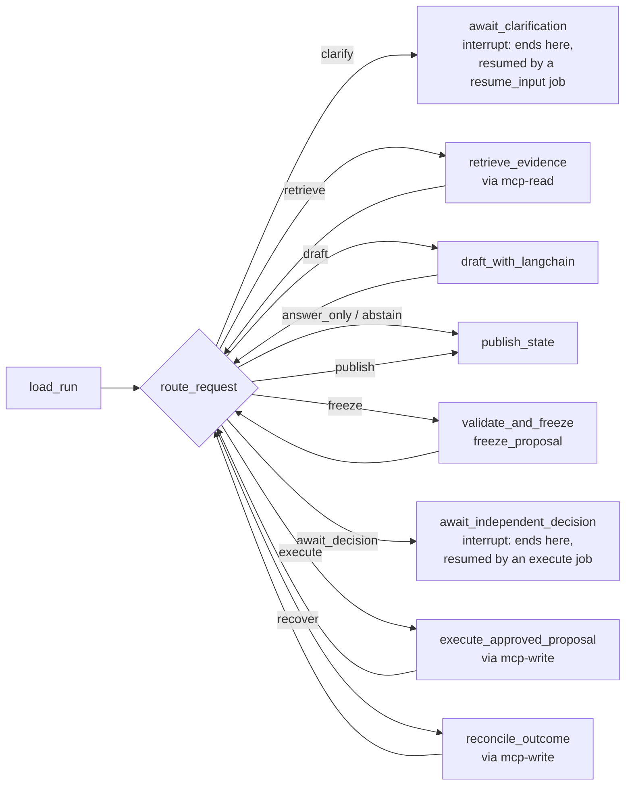

# Architecture: what this project demonstrates

Operations Copilot exists to show four things an interviewer should be able to verify in the code, the tests and the demos: **least privilege**, **routers**, an **orchestrator**, and **MCP servers**. This page is the map. Each section names the components, the requirement IDs whose tests prove the claim (`handoff/acceptance-matrix.json`), and the demo that shows it. The rules themselves live in `SPEC_AMENDMENTS.md` (cited as AM-nn).

> **Status: target design; no code exists yet.** `STATUS.md` says what is built. Every "Planned proof" table names the tests that will exist when the owning task is done, and "Where the code will live" is a plan, not a listing.
>
> **Not claimed for v1:** a tested Kubernetes deployment; multiple fenced worker replicas (one worker runs); a third-party-reviewed holdout (the owner writes it); detection of evaluation differences under about 30 points (n≈25); instant failure after a lost response (abort waits up to 5 minutes); automatic undo of anything (ADR-0002, AM-13, AM-50).

## The system in one picture

The model (bottom right) has no credential, no database access, no network reach and no tool it can call. It receives evidence and returns text. Everything that can change the world sits on the left. A write needs an independent reviewer's decision bound to the exact payload hash, and then the final grant inside the database, which re-checks membership, hash, expiry, cancellation and the asset guard in one transaction (AM-13, AM-20.3).

---

## 1. Least privilege

**Claim.** Every principal holds exactly the authority its job needs, enforced by the database, the identity provider and the network, not by application code being careful.

### Principals and what each one holds

| Principal | Credential | Database access | Can reach | Cannot |
|---|---|---|---|---|
| Browser user | Opaque server-side session cookie; CSRF token; no provider token | none | api only | hold a token, reach MCP or the databases |
| `api` | Keycloak client; DB role `api` | SELECT on conversation and audit tables; INSERT on messages, idempotency, feedback, outbox, `resume_input` jobs; UPDATE on `runs.cancel_requested` only; runs, decisions and revisions only through `create_run`, `record_decision`, `create_revision`; status answers and conversation clarifications are plain messages | PostgreSQL, Keycloak (login, `view-users` check) | update `runs.state`; insert decisions, proposals, grants, attempts or events directly; reach either sim |
| `worker` | Keycloak client; DB role `worker` | run_lease, jobs, drafts, invocation_context (insert), outbox (insert), corpus tables (ingestion), model_permit, checkpoints schema; `runs` columns `checkpoint_id`, `budget_used`; transitions only through `transition_run` (pre-grant states), `freeze_proposal`, `mark_unknown` and `escalate_run`; handle revocation through `revoke_handles` | PostgreSQL, mcp-read, mcp-write, Ollama | write decisions, memberships, grants, attempts or events; mark a run SUCCEEDED; reach either sim |
| `sweeper` (runs, T11) | DB role `sweeper`; Keycloak `view-users` service account | leases (reclaim), jobs, memberships (sync), outbox, expired sessions and idempotency rows; expiry and deadline transitions only through `expire_proposal` and `escalate_run`, iterating tenants | PostgreSQL, Keycloak admin API (read) | decisions, grants, attempts, any pre-grant or success transition |
| `mcp-read` | Keycloak client; DB role `mcp_read` | **no tables**; `EXECUTE` on `resolve_invocation`, `asset_scope`, `search_procedures_scoped` | PostgreSQL (functions), asset-sim | any write-path function; incident-sim |
| `mcp-write` | Keycloak client; DB role `mcp_exec` | **no tables**; `EXECUTE` on `resolve_invocation`, `grant_execution`, `mark_sent`, `record_outcome`, `request_abort`, `lookup_action` | PostgreSQL (functions), incident-sim | the search and asset functions; asset-sim; it sees only the frozen payload bytes, never corpus text |
| `operator` CLI | DB role `operator` | `EXECUTE` on `resolve_escalation` only | PostgreSQL | everything else |
| `app_definer` | no login | owns the functions, owns no tables; sees rows only through explicit RLS policies | — | be used by a process |
| Model | **none** | none | nothing outbound; it answers requests from the worker only | call a tool, see a credential, assert an outcome, select a route |

The full grant table is AM-20.2; the function contracts (callers, inputs, locks, transitions, events) are AM-20.3; the policies are AM-20.5.

### Mechanisms

- **Capability handles.** A worker calls an MCP server with a short-lived, hashed handle bound to one run, one lease fence, one server (read or write) and the token's client ID. The server derives the tool allowlist from the job type, run state and attempt state (AM-15, AM-20.3). The worker cannot choose its own allowlist.
- **Token audiences.** Each MCP server verifies `aud` against its own resource URL and `azp` against the allowed workload clients. A browser token or a worker token presented to incident-sim is rejected (AM-20.7).
- **The final gate is a database function.** `grant_execution` re-checks membership, hash, expiry, cancellation and the asset guard inside one transaction, and only `mcp_exec` may call it. Approval text, model text and chat text never grant anything.
- **Append-only audit.** Decisions, proposals, grants, attempt states, events and operator resolutions are insert-only for every runtime role; "state" is the latest row.
- **Network.** Every published port binds to 127.0.0.1 (T05); the worker-to-sims and browser-to-internal paths are denied at the Docker network level (R066); Ollama runs on the host and is restricted to loopback and the Docker subnet by an owner-applied firewall rule (AM-31), so "the model cannot reach the destination" is a host-firewall fact, not a container test.

### Planned proof

| Requirement | What its test will show |
|---|---|
| R084, R124, R128 | `mcp_read`/`mcp_exec` cannot SELECT any table; every role holds exactly its grants; direct writes to audit tables fail |
| R106 | Definer functions are hardened and tenant-isolated by explicit policy text |
| R131 | A read handle presented to mcp-write is rejected; mcp-read cannot execute a write function |
| R026, R027, R085, R100 | Wrong audience, replayed handle, worker-chosen allowlist and cross-run proposal all fail |
| R043, R093, R044 | Self-approval and author-approval denied; approval bound to the exact payload hash |

**Demo 2 (denial):** a cross-team or injected attempt is rejected with no incident written and a clear user state (BUILD_SPEC §28).

---

## 2. Routers

**Claim.** Every path a request can take is enumerable in advance, chosen by deterministic rules first, and no input the router cannot classify ever starts work. Model output may *hint* at a route; it never *selects* one.

There are three routers (AM-16):

| Router | Lives in | Input | Routes | Rule |
|---|---|---|---|---|
| **Admission router** | `api` | an authenticated message | `investigate` (new run), `clarification_reply` (resume), `status_question` (answer from records, no run), `readonly_answer` (read-only run, no proposal), `clarify` (conflicting or missing fields), `reject` | Structured fields and `kind` decide; a status question never creates a job; a conflict between text and structured fields becomes a clarification, not a guess (R018) |
| **Graph router** | the orchestrator's `route_request` node | run state, `runs.intent`, resolved context, evidence sufficiency (a code rule), the validated draft kind | `clarify`, `retrieve`, `draft`, `answer_only`, `abstain`, `freeze`, `await_decision`, `execute`, `recover`, `publish` | A route table in `core/routing.py`; conditional edges only from that table; the model's output can only choose between abstaining and drafting, and `freeze` is additionally gated by the requester's intent |
| **Model router** | `DraftGenerator` factory in the worker | `MODEL_MODE` and policy | `fake` (deterministic, tests), `qwen3:8b` (local), a future larger model | Chosen by configuration, recorded in every run's manifest and `explanation.ready` event; **no silent fallback** between routes |

### Planned proof

| Requirement | What its test will show |
|---|---|
| R129 | Every admission and graph route is enumerated; an unroutable or ambiguous input produces a clarification or a 422 and never a job |
| R017, R018 | One active run per conversation; relative intervals resolve once and conflicts clarify |
| R130, R041 | The model route is recorded; a missing model fails clearly instead of falling back |
| R036, R125 | Instructions found in retrieved documents cannot add a tool or authority, and a draft cannot assert a supersession |

**Demo 1 (success)** shows the admission router creating one run and the graph router moving it through retrieve → draft → freeze → await decision → execute.

---

## 3. Orchestrator

**Claim.** One explicit LangGraph graph coordinates the investigation. It is durable, resumable after a crash, and never the source of authority.

### The graph

Every node returns to `route_request`, and every labelled edge is one row of the AM-16 route table (ten routes). The two interrupt nodes end the graph run; a committed human event and its wake-up job start a new run of the graph from the stored checkpoint. Nodes are deterministic Python; only `draft_with_langchain` calls the model, and only `retrieve_evidence`, `execute_approved_proposal` and `reconcile_outcome` call MCP servers.

### Properties

- **Evidence before drafting.** The draft node cannot run until `retrieve_evidence` has returned permitted, versioned evidence (R038).
- **Durable pauses.** Clarification and review are `interrupt()`s with a persisted checkpoint; the human's reply arrives as a committed event and a wake-up job, never as trusted resume content (R022, R023, R042).
- **Crash-safe.** Checkpoints are written synchronously; the accepted checkpoint ID is stored on the run under the lease fence; every node is idempotent because LangGraph re-runs a node from its start on resume (AM-12, R108).
- **Not the authority.** Graph state carries IDs and hashes only (R091). The run's state, the approval and the destination receipt live in PostgreSQL and are rechecked by every node. A checkpoint can never approve or execute anything.
### Planned proof

| Requirement | What its test will show |
|---|---|
| R038 | A trace shows MCP reads complete before the draft node |
| R042, R108 | Pause/resume survives a worker restart from the stored checkpoint; a stray newer head is ignored |
| R087, R088, R107 | Only the current lease fence can write; a 30 s+ model call keeps the lease; a stale worker's write is rejected |
| R094, R109 | Every grant-to-receipt crash window ends in exactly one truthful outcome |

**Demo 3 (recovery):** `docker kill` the worker between destination commit and acknowledgement; the restarted worker reconciles the original action ID and the destination holds exactly one incident.

---

## 4. MCP servers

**Claim.** Tools cross one standard, authenticated protocol boundary, split into two servers so that the server which can *read* evidence cannot *write* incidents and the server which can write cannot read evidence.

| | `mcp-read` | `mcp-write` |
|---|---|---|
| Tools | `get_asset_status`, `get_recent_alerts`, `search_procedures` | `create_incident`, `get_incident_receipt`, `abort_incident` |
| Handle types accepted | `investigate`, `resume_input` jobs | `execute`, `recover` jobs |
| Token audience | `MCP_READ_RESOURCE_URL` | `MCP_WRITE_RESOURCE_URL` |
| DB role | `mcp_read` (3 functions) | `mcp_exec` (6 functions) |
| Downstream | asset-sim, governed corpus (through functions) | incident-sim |
| Cannot | grant, dispatch, abort, see receipts | search, read asset data, see corpus text (it sees only frozen payload bytes) |

- Protocol revision 2026-07-28 over Streamable HTTP; per-request protocol version validated (AM-30).
- Tool inputs have JSON schemas; arguments that try to supply a role, tenant, actor or approval are rejected (AM-15).
- Results are typed envelopes; a transport success can still be an application failure, and the caller verifies receipt hashes before recording success.
- The model never calls either server. The orchestrator's deterministic nodes do, with a handle the server resolves to a run, a fence and an allowlist.
- Neither server is the scheduler or the permission policy; an argument saying "approved=true" is rejected at the schema.

### Planned proof

| Requirement | What its test will show |
|---|---|
| R025 | An independent process lists and calls tools over the network |
| R026, R027 | Wrong or missing audience, browser token, replayed or expired handle rejected |
| R028, R029, R030 | Read tools enforce current access; unexpected tools fail closed; receipt lookup is restricted to recovery |
| R131 | mcp-read holds only the three read-path functions and rejects write handles; mcp-write holds only the six write-path functions and rejects read handles (both share `resolve_invocation`) |
| R096 | The destination's action key is atomic, permanent and accepts only mcp-write's identity |

All three demos cross the MCP boundary.

---

## 5. Leases, fences and the lock order (built in T13)

**Claim.** At most one worker writes for a run at a time, and a worker that has lost the run cannot write anything,
even if it does not know yet.

- **One lease per run, fenced.** The claim and the lease commit together; every write unit locks the lease row first
  and checks owner, fence and expiry on the database clock; MCP handles carry the fence, are refused once it moves or
  the lease lapses, and are checked at use rather than at mint; the definer functions behind both MCP servers check
  it in one helper (`_resolve_handle`).
- **A heartbeat that cannot be starved and cannot keep a corpse alive.** It runs on its own thread and connection,
  renews only while the event loop shows signs of life and the job is within its compute budget, and when renewal
  fails cancels the job's MCP or model call in flight (never a database unit).
- **One lock order.** `core/src/ops_core/locking.py` lists it; a unit test places every table and every transaction
  in it, and a live stress test hammers it.

| Requirement | What its test shows |
|---|---|
| R019 | A killed owner's job is reclaimed after expiry and taken at fence + 1 |
| R020 | A stale fence's unit, mint, release and handle all refuse after a takeover |
| R087 | A resume job waits behind the original job's lease, then writes alone |
| R088 | A 25 s blocked loop and a 35 s drafter keep the lease; a forced renewal failure cancels and revokes |
| R107 | An 8-connection stress test: no deadlock; the interleavings, fenced-definer and R019 tests: no stale write; expiry after the lock |

---

## 6. The event journal, wake-ups and the outbox (built in T14)

**Claim.** A run's events are numbered without gaps in the order they commit, whoever writes them; a notification
is promised in the same transaction as the event that needs it and attempted, apart from the run, until delivered
or dead-lettered; and a wake-up the worker consumed without moving its run is noticed and re-armed.

- **One counter under one lock.** `_append_event` takes the run row `FOR UPDATE`, `next_event_seq + 1` and the
  insert in the writer's transaction; a cursor on the events route therefore never skips.
- **Payload rules in the database.** The payload's keys are the schema's, and only the destination asserts a
  status; the schema, `event_rules_ok` and the SQL give one verdict on one table of cases.
- **A transactional outbox, delivered by the sweeper.** Intent is written by `_append_event`; delivery claims with a
  lease, sends outside any transaction (a log line in v1), records the result apart from the run, backs off,
  dead-letters and announces the dead letter with an event of its own transaction.
- **Wake-ups are jobs.** The sweep re-arms a consumed job whose run did not move; a released lease makes deferred jobs
  due at once; polling remains the wake mechanism.

| Requirement | What its test shows |
|---|---|
| R024 | A failed delivery retries, dead-letters and is announced once; the run is untouched; a replay adds no intent |
| R089 | Four roles' writers wait on the run lock; the route never shows n + 1 before n; a stress run ends gap-free |

---

## 7. mcp-read's door (built in T15)

**Claim.** A read tool answers only a request in the pinned protocol, carrying the worker's own access token and a
handle that still belongs to an open job of a live run in one of its job type's states; every other request is
refused before it learns anything, and nothing about the handle is written down.

- **The version first.** A guard in front of the SDK refuses any POST without `MCP-Protocol-Version: 2026-07-28`
  (400, `-32022`), before authentication; the SDK's own ladder then refuses a header that disagrees with `_meta`.
- **The token second.** Signature, issuer, expiry, `aud` holding this server's resource URL, `azp` the worker, the
  access-token `typ`; the SDK adapter refuses an `aud` without this server's URL before it stamps the resource (the
  SDK's own resource check is a second layer). Any failure is 401.
- **The handle third, in the database.** Its hash, the run's lease (shared lock), the fence and expiry, revocation, the
  `azp`, the job (its own run's, unfinished) and the server derived from the job type; then, in Python, the job
  type's tools and run states. Every refusal is the same plain envelope.
- **Least privilege.** `mcp_read` can execute `current_time` and `resolve_invocation` and nothing else; the search
  itself still reads the fixture corpus (T17 brings the governed store, T16 the asset tools).

| Requirement | What its test shows |
|---|---|
| R025 (read half) | An independent mcp-read process is listed and called by the official client over the network |
| R026 | Tokens for another audience or client are 401 on the request the worker's token passes |
| R027 | A handle dies with its job, expiry, lease, fence and release, over HTTP; no log record holds it |
| R085 | The tools come from the job type and run state; an unregistered tool is the SDK's error |
| R131 (read half) | `mcp_read` executes two functions only; a recover and an execute handle at mcp-read are refused |

---

## 8. mcp-write's door and the recovery tools (built in T47)

**Claim.** Only the worker's execute and recover jobs reach the destination, every send and abort is recorded before
it leaves, and a recovery call can observe or end an existing action but never start one.

- **The same door as mcp-read.** The version guard, then the worker's access token (`aud` mcp-write's URL, `azp` the
  worker's client, `typ` Bearer), then the handle in the database with the token's `azp`: the five write-path
  functions compare it themselves (revision 0010), so the worker's client is named once, in settings.
- **The allowlist has three dimensions.** The job type's tools and run states, and the latest attempt state: an
  execute job creates with no attempt, INTENT or SENT (the re-send after a lost reply), and at ABORT_REQUESTED is
  answered UNKNOWN with nothing sent, so its re-queue after a failed abort parks the run in OUTCOME_UNKNOWN instead of
  stranding it EXECUTING; a recover job redispatches INTENT only, looks up SENT, ABORT_REQUESTED or RESOLVED, and
  aborts INTENT, SENT or ABORT_REQUESTED.
- **Nothing leaves before it is written.** `mark_sent` commits SENT before the POST, and every send passes it, a
  re-send of a SENT attempt included: under the runs lock it refuses a cancelled run (`cancelled`), one past the
  five-minute dispatch deadline (`expired`), an attempt with an abort requested, and a recover job's re-send, writing
  nothing. On `cancelled` or `expired` `create_incident` aborts instead of sending; on an abort already requested it
  answers UNKNOWN; a recover job's re-send is a plain `NOT_REDISPATCHABLE` error. `request_abort` commits
  ABORT_REQUESTED, with the reason it chose, before the abort POST; no incident POST ever follows it. Only the moment
  between `mark_sent`'s commit and the POST itself is left, as AM-13 has it.
- **Recovery observes.** `get_incident_receipt` is one GET of the action's key: a matching receipt, a tombstone or
  another hash is recorded; a 404 or no answer stays UNKNOWN. It creates no grant, attempt, job or key; an abort adds
  only its attempt-state rows and the destination's tombstone.
- **Least privilege.** `mcp_exec` executes `current_time` and the six write-path functions and nothing else; v1
  trusts mcp-write for outcome truth (`docs/threat-model.md`).

| Requirement | What its test shows |
|---|---|
| R030 | Execute and investigate handles and an APPROVED run's recover handle are refused at the recovery tools; a lookup changes no count and only GETs |
| R131 (write half) | `mcp_exec` executes seven functions only; read handles are refused at mcp-write; incident-sim refuses mcp-read's token |
| R025, R031 (write half) | An independent mcp-write process is listed and called by the official client over the network |

---

## Where the code will live (not yet written)

| Directory | What to look at first |
|---|---|
| `core/domain/`, `core/routing.py` | the transition table, the route tables, the reason enum, canonical JSON |
| `core/db/migrations/` | roles, grants, definer functions, RLS policies (AM-20 in SQL) |
| `api/` | the admission router and the decision endpoint |
| `worker/graph/` | the orchestrator's nodes and edges |
| `mcp-read/`, `mcp-write/` | the two tool servers and their token verifiers |
| `incident-sim/` | the destination's atomic action-key table |
| `tests/acceptance/` | one file per requirement ID, created by the owning task |
| `docs/PROJECT_HISTORY.md` | the problems found while designing this, and what changed |
